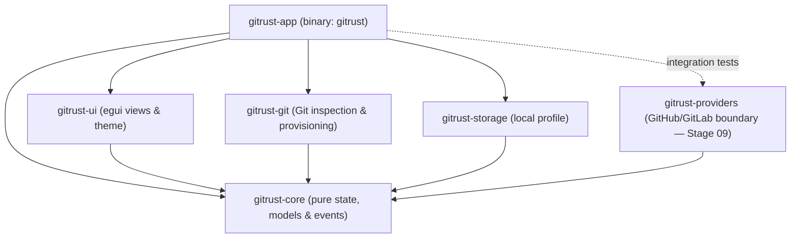

# Architecture Overview

> **Document Scope:** Reflects the Stage 00 foundation and the Stage 01 native shell. [UI architecture](UI_ARCHITECTURE.md) details the presentation layer. Later roadmap stages describe the target architecture. Planned subsystems are explicitly labeled as not yet implemented.

---

## 1. Architectural Goals

1. **Native Desktop Performance & Predictability:** Written 100% in Rust with immediate-mode UI (`egui`/`eframe`) over `wgpu`, avoiding embedded browsers or JavaScript runtimes.
2. **Strict Separation of Concerns:** Acyclic Cargo Workspace crates separating pure application state (`gitrust-core`) from UI rendering (`gitrust-ui`), process execution (`gitrust-git`), persistence (`gitrust-storage`), and remote provider integrations (`gitrust-providers`).
3. **Linux First-Class Portability:** Seamless execution on Linux (Wayland and X11), Windows, and macOS, respecting integrated vs. discrete GPU power profiles.
4. **Security by Construction:** Workspace-wide `#![forbid(unsafe_code)]`, shell-free subprocess execution, non-UTF-8 path fidelity, untrusted repository isolation, and OS-native secret storage.

---

## 2. Cargo Workspace Dependency Graph

All workspace crates form a strict **Directed Acyclic Graph (DAG)**. Circular dependencies and lateral coupling between infrastructure crates are prohibited.

### Crate Responsibilities

| Crate | Status | Responsibility | External Dependencies |
| --- | --- | --- | --- |
| `gitrust-core` | **Implemented** | Pure domain models, workspace actions and snapshots, runtime diagnostics, and the deterministic `AppEvent` reducer. | None (`std` only) |
| `gitrust-ui` | **Implemented** | Native `egui` shell and design system decoupled from OS windowing and headlessly testable via `egui::Context`. | `gitrust-core`, `egui` |
| `gitrust-app` | **Stage 03 implementation** | Native entrypoint, workspace coordinator, dialogs and watcher lifecycle. | `gitrust-core`, `gitrust-git`, `gitrust-storage`, `gitrust-ui`, `eframe`, `egui`, `rfd`, `notify`, `crossbeam-channel`, `tracing`, `tracing-subscriber` |
| `gitrust-git` | **Stage 03 implementation** | Typed Git discovery, local inspection, init and public HTTPS clone. Owns scheduling, subprocess policy and byte-oriented parsing. | `gitrust-core`, `process-wrap`, `tempfile`, `url`, `rustix` (Linux/macOS) |
| `gitrust-storage` | **Stage 03 implementation** | Versioned preferences and workspace catalog, with native local paths and atomic file replacement. | `gitrust-core`, `directories`, `tempfile` |
| `gitrust-providers` | **Boundary Only (Planned Stage 09)** | Strict TLS policy contract. GitHub, GitLab, and hosting API clients scheduled for **Stage 09**. | None (`std` only) |

### Documented Adjustments to the Reference Directory Layout

Per Stage 00 engineering guidelines, two intentional refinements were made relative to the reference directory skeleton:

1. **Workspace Integration Tests (`crates/gitrust-app/tests/` instead of root `tests/`):** Because the root `Cargo.toml` is a **virtual Cargo manifest** (`[workspace]` without a root `[package]`), Cargo only discovers and executes integration tests placed inside member crates (`crates/*/tests/`). Placing `workspace_integration.rs` inside `crates/gitrust-app/tests/` ensures `cargo test --workspace` compiles and executes cross-crate and binary CLI integration tests automatically.
2. **Asset and Benchmark Directories (`assets/` and `benches/`).** Empty directories with placeholder files were omitted in Stage 00. Stage 01 introduces licensed typography in `crates/gitrust-ui/assets` and first-party painted icons. Stage 02 adds an opt-in benchmark harness in `crates/gitrust-git/benches`. Stage 10 can expand measurements based on workloads observed in practice.
3. **Supply-Chain Policy (`deny.toml`):** Added at the workspace root to enforce MIT-compatible dependency licensing and vulnerability checks in CI.

---

## 3. Desktop Shell and Rendering Pipeline (Implemented)

- **Windowing:** `eframe` delegates native OS window management to `winit`, supporting Wayland (`libwayland-client`) and X11 (`x11` / `xcb`) on Linux, Win32 on Windows, and AppKit on macOS.
- **Graphics Backend (`wgpu`):** Selected as the primary backend (`Vulkan` on Linux/Windows, `DirectX 12` on Windows, `Metal` on macOS, with `OpenGL ES` fallback inside `wgpu`).
- **Hybrid GPU Power Policy:** `WgpuSetupCreateNew` defaults to `wgpu::PowerPreference::LowPower` (while honoring `WGPU_POWER_PREF=high|low|none`), preventing a desktop productivity tool from unnecessarily selecting power-hungry discrete GPUs on Optimus/hybrid laptops while still supporting dedicated GPUs seamlessly.
- **Verified Session Diagnostics:** Active windowing protocol (`Wayland`, `X11`, `Win32`, `AppKit`) is verified directly from the runtime `RawDisplayHandle` rather than inferred from environment variables.
- **Event-Driven Repaint:** Views render in response to OS/input events (`ControlFlow::Wait`) and never call `Context::request_repaint()` unconditionally, keeping idle CPU consumption near `0%`.

---

## 4. Git Engine Architecture (Stage 02)

System Git supplies the initial implementation behind a typed `gitrust-git` boundary. [ADR-0003](adr/0003-git-cli-initial-integration-strategy.md) records the adapter choice. [ADR-0007](adr/0007-local-git-inspection.md) defines the narrower local-read trust policy.

Discovery and authorization are separate. Allowlisted requests run in a bounded worker pool and return typed models through a completion channel. The engine constructs every command, using the absolute Git executable, discrete native arguments, literal file selectors and a cleared subprocess environment. Machine formats preserve bytes for Git paths and commit content. The engine keeps subprocess supervision and decoding independent of presentation.

The canonical common Git directory is the scheduler identity for a working tree and its linked worktrees. Read-only operations may coexist. Reserved write classes require exclusive access with writer ordering. The workspace coordinator consumes engine completion notifications. [Git Engine contract](GIT_ENGINE.md)

## 5. Workspace coordination (Stage 03)

The shell sends the repository actions defined in gitrust-core to an application-owned coordinator. The coordinator resolves preferences, invokes the typed Git Engine, handles native folder selection, and owns cancellation and refresh. Only immutable presentation data returns to egui. The engine and storage remain independent of the UI. [Repository management](REPOSITORY_MANAGEMENT.md) · [ADR-0008](adr/0008-workspace-management.md)
