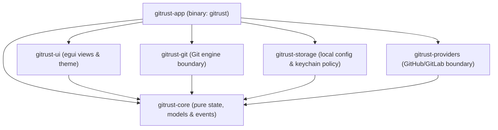

# Architecture Overview

> **Document Scope:** Reflects the implemented **Stage 00 — Project Foundation** baseline and documents the target architecture for upcoming roadmap stages (`Stage 01` through `Stage 10`). Planned subsystems are explicitly labeled as not yet implemented.

---

## 1. Architectural Goals

1. **Native Desktop Performance & Predictability:** Written 100% in Rust with immediate-mode UI (`egui`/`eframe`) over `wgpu`, avoiding embedded browsers or JavaScript runtimes.
2. **Strict Separation of Concerns:** Acyclic Cargo Workspace crates separating pure application state (`gitrust-core`) from UI rendering (`gitrust-ui`), process execution (`gitrust-git`), persistence (`gitrust-storage`), and remote provider integrations (`gitrust-providers`).
3. **Linux First-Class Portability:** Seamless execution on Linux (Wayland and X11), Windows, and macOS, respecting integrated vs. discrete GPU power profiles.
4. **Security by Construction:** Workspace-wide `#![forbid(unsafe_code)]`, shell-free subprocess execution, non-UTF-8 path fidelity, untrusted repository isolation, and OS-native secret storage.

---

## 2. Cargo Workspace Dependency Graph

All workspace crates form a strict **Directed Acyclic Graph (DAG)**. Circular dependencies and lateral coupling between infrastructure crates are prohibited.

### Crate Responsibilities and Stage 00 Status

| Crate | Stage 00 Status | Responsibility | External Dependencies (Stage 00) |
| --- | --- | --- | --- |
| `gitrust-core` | **Implemented (Foundation)** | Pure domain models, metadata, runtime/host diagnostics, `AppState`, and deterministic `AppEvent` reducer. | None (`std` only) |
| `gitrust-ui` | **Implemented (Provisional)** | Native `egui` views decoupled from OS windowing; headlessly testable via `egui::Context`. Definitive Design System scheduled for **Stage 01**. | `egui` |
| `gitrust-app` | **Implemented (Foundation)** | Native binary (`gitrust`), CLI flag handling, `eframe` + `wgpu` initialization, Wayland/X11 integration, and clean shutdown lifecycle. | `eframe`, `egui`, `tracing`, `tracing-subscriber` |
| `gitrust-git` | **Boundary Only (Planned Stage 02)** | Shell-free `GitCommandSpec`, non-UTF-8 `OsString`/`PathBuf` contracts, and operation safety classes. Functional Git CLI engine scheduled for **Stage 02**. | None (`std` only) |
| `gitrust-storage` | **Boundary Only (Planned Stage 03)** | Storage security baseline prohibiting plaintext credentials and telemetry by default. Persistent config and keychain adapters scheduled for **Stage 03 / Stage 08**. | None (`std` only) |
| `gitrust-providers` | **Boundary Only (Planned Stage 08)** | Strict TLS policy contract. GitHub, GitLab, and hosting API clients scheduled for **Stage 08**. | None (`std` only) |

### Documented Adjustments to the Reference Directory Layout

Per Stage 00 engineering guidelines, two intentional refinements were made relative to the reference directory skeleton:

1. **Workspace Integration Tests (`crates/gitrust-app/tests/` instead of root `tests/`):** Because the root `Cargo.toml` is a **virtual Cargo manifest** (`[workspace]` without a root `[package]`), Cargo only discovers and executes integration tests placed inside member crates (`crates/*/tests/`). Placing `workspace_integration.rs` inside `crates/gitrust-app/tests/` ensures `cargo test --workspace` compiles and executes cross-crate and binary CLI integration tests automatically.
2. **Deferred Asset and Benchmark Directories (`assets/` and `benches/`):** Empty directories with placeholder files were omitted in Stage 00. Typography and icon assets will be introduced with verified licensing in **Stage 01 (Design System)**, and `criterion` benchmarks (`benches/`) will be introduced alongside real workloads in **Stage 02 (Git Engine)** and **Stage 09 (Security and Performance)**.
3. **Supply-Chain Policy (`deny.toml`):** Added at the workspace root to enforce MIT-compatible dependency licensing and vulnerability checks in CI.

---

## 3. Desktop Shell and Rendering Pipeline (Implemented)

- **Windowing:** `eframe` delegates native OS window management to `winit`, supporting Wayland (`libwayland-client`) and X11 (`x11` / `xcb`) on Linux, Win32 on Windows, and AppKit on macOS.
- **Graphics Backend (`wgpu`):** Selected as the primary backend (`Vulkan` on Linux/Windows, `DirectX 12` on Windows, `Metal` on macOS, with `OpenGL ES` fallback inside `wgpu`).
- **Hybrid GPU Power Policy:** `WgpuSetupCreateNew` defaults to `wgpu::PowerPreference::LowPower` (while honoring `WGPU_POWER_PREFERENCE`), preventing a desktop productivity tool from unnecessarily waking power-hungry discrete GPUs on Optimus/hybrid laptops while still supporting dedicated GPUs seamlessly.
- **Event-Driven Repaint:** Views render in response to OS/input events (`ControlFlow::Wait`) and never call `Context::request_repaint()` unconditionally, keeping idle CPU consumption near `0%`.

---

## 4. Planned Git Engine Architecture (Stage 02 Target — Not Yet Implemented)

### 4.1 Strategy: Git CLI Primary, Gitoxide Evaluable

gitRUST will initially execute operations through the system `git` executable behind an explicit Rust port/adapter boundary in `gitrust-git` (see [`ADR-0003`](adr/0003-git-cli-initial-integration-strategy.md)).

Why start with Git CLI:
- Full behavioral parity with user `.gitconfig`, `includeIf`, SSH agents, GPG/SSH commit signing, Git LFS filters, sparse checkouts, submodules, and worktrees.
- Battle-tested repository integrity guarantees (`index.lock`, atomic ref updates, packfile verification).

Why isolate behind traits for future `gitoxide` (`gix`) evaluation:
- Pure-Rust read paths (e.g., high-frequency status inspection, commit-graph walking, blame, or diffing) can later be benchmarked and selectively backed by `gix` where compatibility and safety are proven, without rewriting `gitrust-core` or `gitrust-ui`.

### 4.2 Mandatory Git Engine Invariants (Stage 02+)

1. **Zero Shell Execution:** Commands are spawned strictly via `std::process::Command` (or async equivalent) using discrete `OsStr` arguments (`GitCommandSpec`). Shell wrappers (`sh -c`, `cmd /C`) are forbidden.
2. **Option Termination Discipline:** Dynamic revisions and paths are separated with `--` and `--end-of-options` where supported to prevent leading-dash argument injection.
3. **Non-UTF-8 Path Fidelity:** Repository paths and file entries use `PathBuf`, `OsString`, and raw byte parsers (`--porcelain=v2 -z` NUL-delimited output) rather than assuming UTF-8 filenames.
4. **Sanitized Subprocess Environment:** Interactive prompts are suppressed (`GIT_TERMINAL_PROMPT=0`, `GCM_INTERACTIVE=never` unless explicitly routed through an approved credential flow), `LC_ALL=C` is set for deterministic machine parsing where needed, and dangerous config overrides are neutralized via `-c` flags when inspecting untrusted repositories.
5. **Asynchronous Execution & Safe Cancellation:** Git subprocesses run on background worker tasks communicating with `gitrust-core` via bounded channels (`egui::Context::request_repaint` triggered on completion). Cancellation terminates read-only child processes cleanly; mutating operations respect Git lockfiles and reconcile repository state afterward.
6. **Per-Repository Write Serialization:** Concurrent read operations may run within bounded concurrency, whereas all mutating operations (`SerializedWrite` / `DestructiveWrite`) acquire an asynchronous per-repository mutex/queue so `gitRUST` never triggers self-inflicted `.git/index.lock` races.
7. **Explicit Destructive Operation Gating:** Commands capable of discarding uncommitted data or rewriting history (`reset --hard`, `checkout -- <file>`, `clean -fd`, `branch -D`, `push --force-with-lease`) require typed confirmation tokens generated only by explicit user authorization in the UI.
