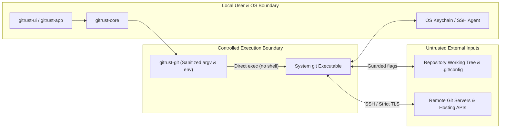

# Preliminary Security Architecture

This document defines the security model, trust boundaries, threat analysis, and mandatory engineering controls for **gitRUST** starting at Stage 00.

---

## 1. Security Philosophy

A desktop Git client operates at a high-value intersection: it parses untrusted repository contents from external collaborators, invokes local developer tools (`git`, SSH, GPG, credential helpers), and interacts with authenticated remote servers.

gitRUST adopts a **defense-in-depth, zero-trust-toward-repositories** posture:

1. **Every opened or cloned repository is treated as potentially untrusted input.**
2. **Memory safety is enforced without exceptions** (`unsafe_code = "forbid"` across workspace crates).
3. **Subprocesses never pass through command shells.**
4. **Secrets never touch gitRUST plaintext configuration or diagnostic logs.**
5. **Privacy is preserved by default** (zero telemetry, zero unsolicited network calls).

---

## 2. Trust Boundaries

---

## 3. STRIDE Threat Model & Controls

### 3.1 Tampering & Arbitrary Code Execution via Malicious Repositories

**Threat:** Opening or inspecting a crafted repository triggers arbitrary code execution via `.git/config` directives (`core.fsmonitor`, `core.sshCommand`, `core.pager`, `core.editor`, `diff.external`, clean/smudge filters) or `.git/hooks/*`.

**Stage 02 controls**

- Identify candidates without Git execution. Before inspection, require explicit authorization of stable local metadata and validate the layout, config and reference backend. Disable local config includes during preflight. Reject disallowed configuration, including content filters, which can apply to status and diff.
- Clear the subprocess environment and exclude system/global config and attributes, optional locks, replacement refs, pagers, prompts, external diff and text conversion. Preserve Git's ownership checks. The policy refuses external object stores, promisor repositories and unsupported Git directory indirection.
- Launch only the absolute native Git chosen from trusted PATH entries or by the caller. Disable transports and lazy fetch even when harmless remote metadata is present. Filesystem and executable provenance remain trust assumptions. [Git Engine contract](GIT_ENGINE.md)

### 3.2 Command and Argument Injection

**Threat:** Repository-controlled names, revisions, paths or configured extensions alter command interpretation.

**Stage 02 controls**

- The engine alone constructs the arguments of a closed set of Git operations. It uses native argument arrays, full object IDs, validated reference names and literal repository-relative paths. Use `--end-of-options` for supported revision commands and `--` for path or ref operands.
- The Stage 02 inspection commands grant no transport access. Stage 03 uses separate typed provisioning commands and an HTTPS-only clone policy.

### 3.3 Information Disclosure (Credentials & Logs)

**Threat:** Personal access tokens, passwords, SSH passphrases, or private URLs with embedded credentials leak into config files, crash reports, or terminal logs.

**Controls:**
- **Declarative Baseline Defined in Stage 00 (`gitrust-storage`, `gitrust-providers`), Runtime Enforcement in Stages 03/06/07:** `StorageSecurityBaseline` and `TlsVerificationPolicy` codify the prohibition on plaintext credential files, default telemetry, and TLS verification bypasses as compile-time constants (`no HTTP/storage I/O exists in Stage 00`). `tracing` logs in `gitrust-app` record only non-sensitive metadata (version, OS, graphics adapter, viewport metrics) and never dump environment variables.
- **Stage 03:** Accept only public HTTPS sources and reject URL user information. The local profile holds preferences and workspace paths.
- **Stage 06:** Use approved Git credential helpers or OpenSSH with an existing agent on Linux. Reject embedded URL credentials and discard unfiltered network diagnostics. Provider credential storage remains a future integration.

### 3.4 Spoofing & Man-in-the-Middle (Transport Security)

**Threat:** Compromised networks intercept HTTPS remote operations or hosting API calls.

**Controls:**
- **Implemented in Stage 00 (`gitrust-providers`):** `TlsVerificationPolicy::StrictCertificateVerification` is codified as mandatory.
- **Stage 03:** Force TLS verification for the public HTTPS clone. The same verification requirement applies to future provider and transport operations.

### 3.5 Denial of Service & Repository Corruption

**Threat:** Concurrent mutating Git commands corrupt `.git/index` or leave stale `.git/index.lock` files; huge untracked directories or binary diffs exhaust UI memory; accidental destructive commands erase uncommitted work.

**Controls:**
- The Stage 02 scheduler reserves exclusive access for repository write classes by canonical common Git directory. Stage 03 provisioning operates on a separate scratch directory and publishes to a new destination.
- Stage 02 bounds stdout, stderr, queued requests, task time and decoded items. Unix process groups and Windows Job Objects support termination of active reads. Stage 04 can use the typed models for virtualized rendering.
- Explicit confirmation gates for `DestructiveWrite` operations; automated destructive tests restricted strictly to ephemeral temporary directories (never real repositories).

---

## 4. Supply-Chain and Memory Safety Controls

- **Zero Workspace `unsafe`:** `[workspace.lints.rust] unsafe_code = "forbid"` prevents accidental memory-unsafety in first-party crates.
- **Minimal Dependency Footprint:** No web engines, scripting runtimes, or redundant utility crates. `eframe` is configured with `default-features = false` to exclude web targets (`web_screen_reader`).
- **Automated Auditing:** `deny.toml` and GitHub Actions (`EmbarkStudios/cargo-deny-action`) verify permissive MIT-compatible licenses, reject yanked crates, forbid wildcard version specs, restrict registries to `crates.io`, and check RustSec advisories on every pull request.

## Stage 03 provisioning and profile

The native application is a session trust coordinator. It stores no credentials, tokens or approval state in its profile. Local inspections preserve the validated-config allowlist, Git ownership checks and disabled network policy. The only LFS-related metadata accepted is the inert local repository-format marker with value zero. Filter configuration remains prohibited.

Stage 03 cloning used a cleared environment, public HTTPS with TLS verification, and blocked redirects. Stage 06 extends the boundary to explicitly authenticated HTTPS and SSH. Initializing and cloning use empty templates, private staging, and no-replace publication. The local materializer enables HFS and NTFS protections and writes symlink contents as regular files. Network permissions do not carry over to validation or materialization. Checkout filters and nested submodules are not activated. The engine depends on a trusted executable and a stable caller-controlled destination parent. [ADR-0008](adr/0008-workspace-management.md)

URL credentials, queries and fragments are rejected at the input boundary. Clone failures expose the exit status and discard raw process streams. A successful clone retains the accepted source as Git's local origin, so submit only addresses intended to be retained. The app cannot recognize a secret encoded as an opaque URL path. The profile keeps no clone URL and the workspace view receives only an endpoint-presence flag.

The no-replace guarantee applies when a competing entry appears at the final destination, including a symlink where supported. The caller controls the parent and its ancestors for the operation's lifetime. Paths are not held by directory handles on every platform, so replacing an ancestor concurrently remains outside the threat boundary. Cancellation after publication preserves the completed repository and its success result.

On Windows, publication uses the audited `tempfile` Windows backend to request `MoveFileExW` with neither replacement nor cross-volume copying. The private staging directory owns cleanup. The native CI test creates an empty destination after validation and checks that publication preserves both entries.

## Stage 04 local mutations

Changes and commits use the existing local trust boundary and serialized write reservations. The engine validates the authorized repository again, rejects unexpected configuration and locks, and uses literal paths with NUL delimiters. Destructive previews are compared against fresh Git bytes before any restore or deletion. Untracked deletion on Linux and macOS uses open directory descriptors and no-follow semantics. The user must still control access to repository metadata. Git lockfiles and the final compare-and-swap protect individual resources; working-tree restore and index publication do not form one atomic transaction.

Only explicit signing requests can select a verified system signing executable. Private keys and passphrases remain with that executable. Signer output and key identifiers are excluded from workspace notices. Protected repository operations retain the existing network and hook restrictions.

[ADR 0009](adr/0009-local-changes-and-commits.md)

## Stage 05 branches and history

Branch changes use safe Git modes and revalidate full refs and expected commit IDs. Merge requires a clean start, protects ignored files and disables autostash and automatic conflict resolution. Only an in-session state proof permits abort.

[Branches and History](BRANCHES_AND_HISTORY.md) · [ADR 0010](adr/0010-branches-history-and-merge.md)

## Stage 06 transport boundary

Git global and system config stay isolated. Repository configuration passes the local allowlist. The network request grants one protocol and sends a validated endpoint as a discrete argument. SSH verifies the host and only accepts the fixed Git upload or receive service with the approved repository path. It runs without user SSH command, proxy or startup config. Fetch validates its destination tracking namespace and rejects symbolic references targeting another namespace. Rename and removal refuse nonstandard fetch mappings. Push has a single non-forced branch destination. The subprocess supervisor bounds time and output. [ADR-0011](adr/0011-remote-operations.md) · [Authentication](AUTHENTICATION.md)

## Stage 07 GitHub integration

The public Client ID identifies the registered GitHub App. Device Flow, strict TLS and encrypted Linux Secret Service protect session material. Tokens are scoped by account, refreshed on explicit use, and omitted from the workspace profile. Git receives a bearer-derived Basic header only for its reviewed HTTPS repository URL; GitHub REST uses a Bearer header only on the API origin. [Authentication](GITHUB_AUTHENTICATION.md)

## Stage 07.1 OAuth browser authorization

S256 PKCE, a cryptographically random state and a five-minute single-use callback bind the OAuth flow to the initiating instance. The Linux runtime lock, restricted socket and same-UID peer checks guard local delivery. The browser Client Secret is provisioned separately in Secret Service. An OAuth session is bound to its GitHub account and Client ID and is isolated from Device Flow. The OAuth scope `repo` covers broadly what the account can access subject to organization policy. The Git and REST credential boundaries remain scoped to HTTPS. [ADR-0013](adr/0013-native-browser-oauth.md)
